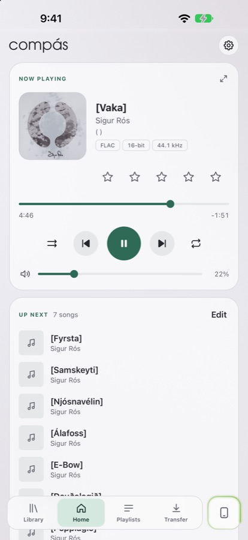
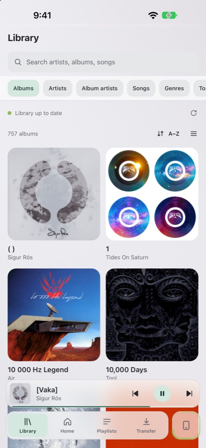
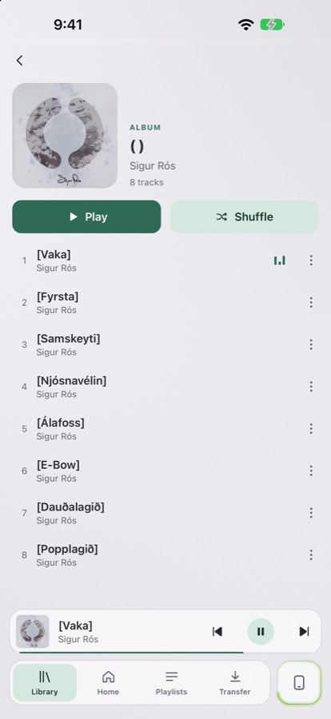
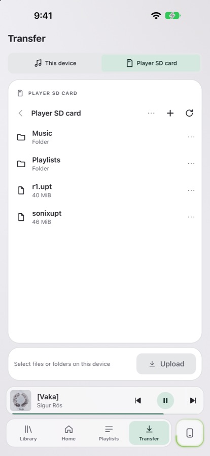
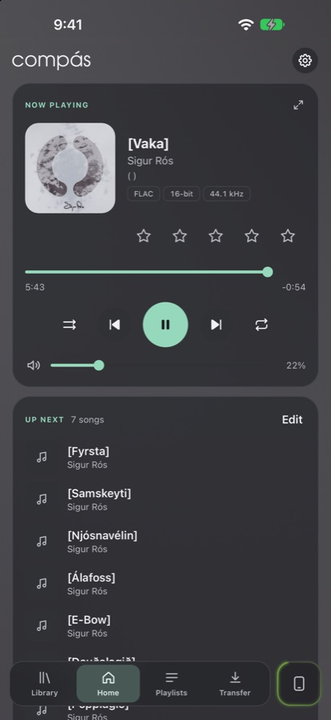
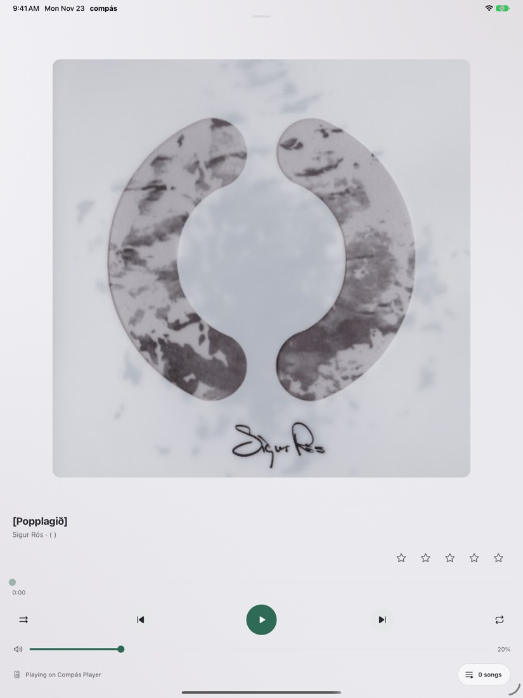
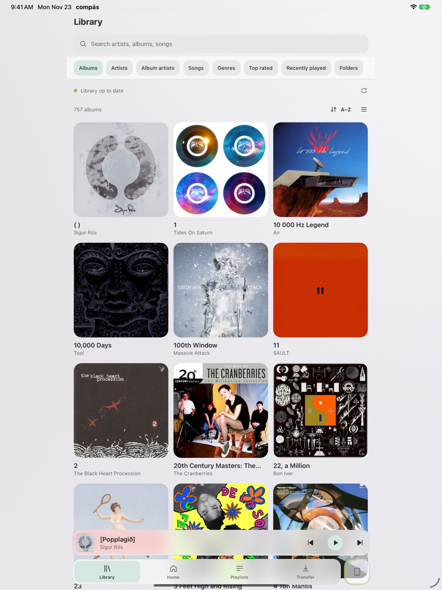
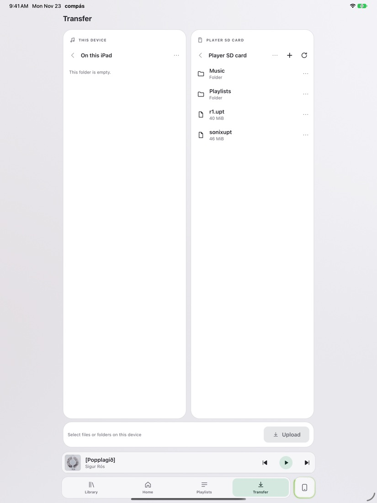
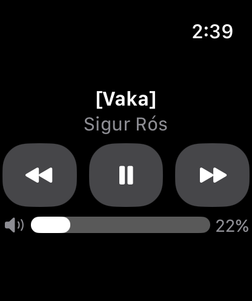

# compás Remote for iPhone, iPad and Apple Watch

An unofficial port of the [Compás Remote](https://github.com/Starnished66/compas-app) companion app to Apple platforms.

[Compás](https://compasplayer.org/) is custom firmware for the HiBy R1 digital audio player. Compás Remote lets a phone control the player: what's playing, the queue, the library, playlists, and copying music to its SD card. The original app is Android-only. This fork adds iOS, iPadOS and watchOS support.

> **Status:** working in the iOS Simulator and tested against a real HiBy R1. It's not yet on TestFlight or the App Store. This is a community port, not affiliated with or endorsed by the Compás project or HiBy.

## Screenshots

### iPhone

<p>
  
  
  
  
  
</p>

### iPad

<p>
  
  
  
</p>

### Apple Watch



Taken in the iOS Simulator connected to a real HiBy R1. Full-size App Store versions are in [`docs/app-store/screenshots/`](docs/app-store/screenshots/).

---

## What works

| Feature | iPhone / iPad | Notes |
|---|---|---|
| Find the player on Wi-Fi | ✅ | Automatic (Bonjour) or by typing its address |
| PIN pairing | ✅ | The PIN is stored in the iOS Keychain |
| Now Playing, queue, playback controls, volume | ✅ | Same interface as Android |
| Library and playlists | ✅ | Syncs the player's library and album covers |
| File transfers to/from the SD card | ✅ | Uses the app's folder in the Files app (see below) |
| Light / Dark / System appearance | ✅ | Settings → Appearance |
| iPad, portrait and landscape | ✅ | Content stays centred on wide screens |
| 14 languages | ✅ | Shared with the Android app |
| **Bluetooth connection** | ❌ | Not possible on iOS (see limitations) |
| Lock-screen / Control Center controls | ⏳ | Planned |

### Apple Watch

A small SwiftUI watch app shows the current song and artist, with previous, play/pause and next buttons, and volume on the Digital Crown.

The watch never talks to the player directly. It sends each command to the iPhone app, which forwards it to the player over Wi-Fi. Your iPhone needs to be nearby with the compás app installed and connected to the player at least once.

## Limitations on iOS

- **Wi-Fi only.** The player's Bluetooth remote uses Bluetooth Classic (RFCOMM/SPP). iOS only allows that for Apple MFi-certified accessories, so the Bluetooth option is hidden on iPhone and iPad. If the firmware ever adds Bluetooth Low Energy, it could be supported.
- **No in-app updates.** The Android app can download and install its own updates. On iOS, updates come through the App Store.
- **Music folder.** iOS apps can't browse the whole phone. To send music to the player, put it in **Files → On My iPhone → compás → Music** (or drag it in from a Mac with Finder), then use the Transfer tab.

---

## Building it yourself

### Requirements

- A Mac with **Xcode**, including the iOS Simulator, plus the watchOS Simulator for the watch app (Xcode → Settings → Components).
- **Node.js** (current LTS).
- **CocoaPods** on **Ruby 3 or newer**. The Ruby built into macOS is too old.
  - With Homebrew: `brew install node cocoapods`.
  - Without Homebrew: install Node and a standalone Ruby into your home folder, then run `gem install cocoapods`.
- **The project folder must not have spaces in its path.** Expo's build scripts break on them.

### Run in the Simulator

```bash
git clone https://github.com/kambiz/compas-app.git
cd compas-app
git switch ios-port
npm install
npx expo run:ios
```

The `ios/` folder is **generated** by `npx expo prebuild` and is not committed. Never edit it by hand. All iOS-specific settings live in config plugins and in the folders listed below, so they survive regeneration.

### Run on your own iPhone

Open `ios/comps.xcworkspace` in Xcode. Select your iPhone and, under *Signing & Capabilities*, your Apple ID as the team, then press Run.

A free Apple ID works for personal testing, but the app has to be reinstalled every 7 days. TestFlight and the App Store need the paid Apple Developer Program ($99/year).

---

## How the port is built

The original app is built with **Expo / React Native**, so the interface and logic (about 52,000 lines of TypeScript) are shared between Android and iOS. What differs per platform is the *native modules*: small pieces of Kotlin (Android) or Swift (iOS) that talk to the operating system.

| Path | What it is |
|---|---|
| `modules/compas-discovery/ios/` | Finds players on the network with Bonjour (`_compas-remote._tcp`), plus a UDP broadcast fallback |
| `modules/compas-files/ios/` | Browses the app's Music folder and uploads/downloads files to the player. Requests never follow redirects, so the PIN can't leak to another host |
| `modules/compas-watch/` | **iOS only.** Relays Apple Watch commands to the player. Only status, play/pause, next, previous and volume are allowed. The PIN stays in the iPhone Keychain |
| `modules/compas-bluetooth/ios/`, `compas-updates/ios/`, `compas-diagnostics/ios/`, `compas-media-session/ios/` | Safe stand-ins for Android-only features |
| `targets/watch/` | The SwiftUI Apple Watch app, added to the Xcode project by [`@bacons/apple-targets`](https://github.com/EvanBacon/expo-apple-targets) |
| `plugins/withCompasIOS.js` | iOS project settings: the iOS 27 scene lifecycle, local-network and Bonjour permissions, and Files-app sharing |

```
Apple Watch ──WatchConnectivity──► iPhone app ──HTTP + PIN over Wi-Fi──► HiBy R1 (Compás)
```

Changes to shared code are kept small and are mostly behind `Platform.OS` checks, so Android behaves as before. One shared change helps both platforms: the playing track's cover is now fetched ahead of the library cover sync.

---

## Roadmap

- [x] Tooling, fork and project setup
- [x] App launches in the iOS Simulator
- [x] Wi-Fi discovery, pairing and playback against a real R1
- [x] File transfers, iPad layout, iOS wording, polish
- [x] Apple Watch remote
- [ ] Test on a real iPhone and Apple Watch
- [ ] Final app name and bundle ID (waiting on the Compás author)
- [ ] TestFlight beta
- [ ] App Store release
- [ ] Lock-screen controls (Live Activity / Now Playing)

### Known issues

- Deleting a folder on the player's SD card only works when the folder is empty; otherwise the app shows "Could not complete the selected action." The player refuses the request, so the fix is either a recursive delete in the app or a clearer message. The confirmation also says "Delete file?" for folders.
- The PIN is saved per player address. If the router gives the player a new address, the app finds it again automatically but asks for the PIN again.
- After removing a song from Up Next, it stays listed for about 5 seconds until the next status update.
- The player can take a few seconds to report a track or volume change, so the Apple Watch may briefly show the previous song.
- The iOS bundle ID is currently `com.compas.remote`, borrowed from the Android app. It must change before an App Store release.
- While the player is playing, it refuses album-cover requests (HTTP 503, "busy"). A first library sync started during playback therefore waits ("Library sync paused") and finishes once playback is paused. The app now backs off (2 s, doubling to 30 s) instead of retrying several times a second; the same fix would help Android.

## Keeping up with the original app

| Branch | Contents |
|---|---|
| `master` | Mirrors the original repository, [Starnished66/compas-app](https://github.com/Starnished66/compas-app) |
| `ios-port` | All iOS work |

To bring in the author's latest changes:

```bash
git fetch upstream
git merge upstream/master
```

The aim is to offer the iOS work back to the original project.

## Credits and license

- **App:** the Compás Remote app and Compás firmware are by the [Compás project](https://compasplayer.org/) and their contributors. All original code belongs to them.
- **Port:** the iOS, iPadOS and watchOS work in this fork follows the original repository's [LICENSE](LICENSE).
- **Names:** "Compás", "compás" and "HiBy" are the names of their respective owners. They're used here only to describe what this app works with.
